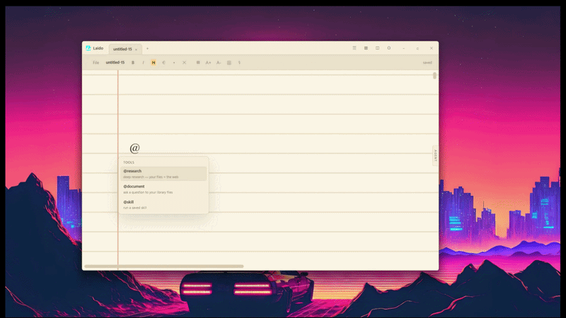

<p align="center">
  
</p>

<h1 align="center">Laido</h1>
<p align="center"><strong>The way of AI — a notepad that acts on what you write.</strong></p>

<p align="center"><a href="https://laido.zraldwebdevelopmentservices.shop">laido.zraldwebdevelopmentservices.shop</a> — sign in, manage keys &amp; plans</p>

<p align="center">
  <a href="https://github.com/Zrald1/laido/releases"></a>
  <a href="https://apps.microsoft.com/detail/9NT11XSG8H4B"></a>
  <a href="https://github.com/Zrald1/laido/actions/workflows/release.yml"></a>
  
  
</p>

<p align="center">
  
</p>

Laido is an always-on personal agent whose memory and interface is a plaintext
notepad. You write notes; Laido reads them, answers from them, researches the
web, runs scheduled work while you sleep, and leaves every result on the page
as an editable widget — never hidden in a chat log.

Your notes are the memory, and the memory is yours.

## Built on Nebius × NVIDIA

Laido runs entirely on **Nebius Token Factory** with **NVIDIA Nemotron open
models**, routed by task cost so everyday calls stay fast and credits stretch:

| Lane | Model | Where it's used |
|---|---|---|
| Fast | `NVIDIA-Nemotron-3-Nano-30B-A3B` | query rewriting, entity-graph extraction, per-file digests, research-loop refinement, simulation-script generation |
| Main | `nemotron-3-super-120b-a12b` | grounded answers, note summaries, research synthesis, loop cards, final reports |
| Deep | `Nemotron-3-Ultra-550b-a55b` | deepest reasoning when a question demands it |
| Embeddings | Token Factory embeddings (1024-dim) | library + notes indexing, every hybrid-retrieval lane |

Every answer Laido gives is a **runtime call to Token Factory** — retrieval
rewriting, synthesis, per-loop simulations and scheduled autonomous work all
go through it. The only other runtime services are **Tavily** (web research
lane) and **AssemblyAI** (optional voice notes). Everything else — notes,
vectors, graphs, schedules, simulation scripts — is local plain files that
belong to you.

**Why Token Factory:** one task routed across Nano → Super → Ultra costs
fractions of a cent per ask while a 120B-class model stays on the critical
path. The OpenAI-compatible API made the whole agent — including scheduled
runs while the laptop sleeps — a thin, fast layer to build on open
infrastructure.

## What it does

- **A real notepad** — an infinite ruled sheet with draggable, resizable AI
  widgets living beside your text. Everything autosaves to local files.
- **Hybrid retrieval** — vector search + BM25 + entity graph + quantum-inspired
  lanes (density-matrix query, graph walk, interference re-ranking) over your
  embedded library, fused with web research. Cite-first answers.
- **Your whole vault is searchable** — notes are indexed alongside library
  files; `@ask` fuses library + notes + web into one grounded answer.
- **Research loops** — `@loop 10 arxiv breakthroughs in quantization` iterates:
  each loop refines the search angle, synthesizes findings, writes and runs a
  Python simulation of the central claim in a sandbox, and feeds the result
  into the next loop. Loop cards pin themselves in a clean grid.
- **Scheduled autonomy** — `@schedule daily 08:00 brief` and friends. The agent
  works while the laptop sleeps and writes results into your notes, with a
  calendar (month/week/day/agenda) to manage it.
- **Skills** — reusable multi-step routines written in plain lines
  (`@research`, `prompt:`, `remind:`, `summary`, `loop:`), plus built-in
  presets (daily brief, weekly review, meeting prep, research loop…).
- **Voice notes** — record natively and transcribe with AssemblyAI, either
  live streaming (text appears as you speak) or record-then-transcribe.
- **Read widgets aloud** — every AI card has a text-to-speech button.
- **`.laido` files** — notes are plain markdown in `.laido` files inside
  `Documents/Laido`, with the Laido icon on Windows. Copy the folder and you
  moved your agent's memory; delete a file and it forgets.

## Commands

Type a command word — `ask`, `document`, `research`, … — then press **Space** and pick
from the dropdown (Tab or arrows to move, Enter or a click to choose). Or just start
typing: `r` offers research, recall, related; `a` offers ask. No `@` to remember: a
hand-typed word becomes a chip, you type your message, and the command runs when you
press Enter. Pasted text never becomes a command, and **Escape** cancels one back to
plain text.

| Command | What it does |
|---|---|
| `ask <question>` | Library + your notes + web, fused into one cited answer |
| `document <file?> <question>` | Ask a specific library file (or all files) |
| `research <topic>` | Deep research — your files + the web |
| `loop [n] [target] <query>` | Iterative research with per-loop simulations (`loop stop` ends early) |
| `summary [instruction]` | Summarize the current note (including its widgets) |
| `recall [target] [n]` | Quiz yourself from your corpus; schedules spaced reviews |
| `tasks [target]` | Extract action items from files or notes |
| `related` | The notes closest to this one, as `[[links]]` |
| `skill <name>` | Run a saved skill |
| `schedule <spec> <action>` | Recurring agent work (`daily 08:00 brief`, `every 6h`, `mon-fri 09:00 …`) |
| `terminal` / `chat` | An AI terminal widget on the note — ask in plain words, run `! shell commands` (safe ones instantly, the rest behind a Run/Skip confirm), save the session as a skill |
| `sticky` / `schedule` / … | Sticky notes, calendar entries, and more in the pickers |

Click any file in the **Library** to ask it a question directly — the cited answer
lands in your note as a card.

Commands run only when you press Enter on their line — pasting text is safe.

## Download

**Windows** — get it from the
[Microsoft Store](https://apps.microsoft.com/detail/9NT11XSG8H4B) (signed,
auto-updating), or grab `.msi`/`.msix`/`.exe` from
[Releases](https://github.com/Zrald1/laido/releases).

**macOS** — `.dmg` (Apple Silicon) from Releases.
**Linux** — `.AppImage`/`.deb`/`.rpm` from Releases.
**Android** — `app-release.apk` under the
[mobile-nightly](https://github.com/Zrald1/laido/releases/tag/mobile-nightly)
prerelease.

GitHub builds are unsigned, so your OS may ask you to confirm before the
first launch. Every push to `main` is built on all three desktop platforms;
pushing a `v*` tag publishes a release automatically.

## Quickstart

```bash
npm install
npm run dev        # tsc + tauri dev
npm run build      # production bundle
```

Requires Rust (stable), Node 20+, and a system webview (WebView2 on Windows,
WebKitGTK on Linux).

On first launch, open **Settings** and add your keys:

- **Nebius Token Factory** — inference (Nemotron 3 Nano · Super · Ultra,
  routed by task cost)
- **Tavily** — `@research` / `@ask` web lane
- **AssemblyAI** — voice notes

All keys are stored locally in your vault (`.laido/settings.json`), and all
data stays in `~/Documents/Laido` unless you explicitly ask for web research.

## Architecture

- **Rust + Tauri v2 backend, vanilla TypeScript + plain CSS frontend** — one
  small binary for Windows / macOS / Linux, no runtime to install.
- **Local-first storage** — notes, library index, vectors, graphs, schedules
  and simulation scripts all live in the vault folder as plain files.
- **Sandboxed agent** — every file the AI reads or writes resolves inside the
  vault; outside files enter only through your explicit upload.
- **Retrieval** — flat vector files + BM25 + entity graph, fused with
  reciprocal-rank fusion and interference re-ranking; map-reduce for
  corpus-wide summaries.
- **Visible by design** — every AI action leaves a trace: a widget on the
  page or a line in the activity feed. No invisible magic.

## License

Apache-2.0 — see [LICENSE](LICENSE). Third-party notices for the crates
compiled into the shipped binary are in
[THIRD_PARTY_LICENSES.md](THIRD_PARTY_LICENSES.md) (also bundled with the
installer).
